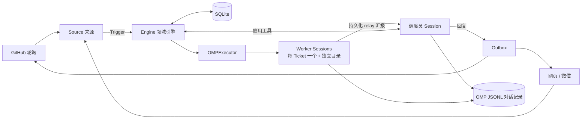

# omp-superagent

**一个能替你干活的"值班程序员"。** 你在 GitHub Issue / PR、本地网页或微信里 @ 它提需求，它先判断"该不该做、谁让做的"，通过后给每个任务开一个独立的 AI 工人，在单独的目录里写代码、跑命令，做完把结果回复到你提问的那个对话里。

基于 [Oh My Pi (OMP)](https://github.com/can1357/oh-my-pi)，一个服务只对应一个 GitHub 仓库。

> 设计原则：**占用人的注意力尽量少，给出的价值尽量多。** 只在被明确请求（或有你写好的规则）时行动；只在需要你决策或有结果时说话；失败如实说失败。

## 它能做什么

- **GitHub**：在 Issue/PR 里 `@agent 修一下 README 的错别字` → 确认收到 → 干活 → 回帖交付结果。
- **网页面板**（默认 `http://127.0.0.1:3082/`）：聊天、上传附件（≤3 个/条，≤5 MiB/个）、查看每个 Worker 进度、在线切换模型、重置会话。
- **微信**：面板「设置 → 微信」扫码绑定，直接在微信里发需求、收文件/图片。
- **不做**：飞书、DSH 托管、在线改 Prompt、Worker 子代理、异步后台任务。

## 快速开始

**前置**：Bun `>=1.4.4`、git `>=2.32`；已配置好模型提供商的 OMP `agentDir`；一个全新的空 `stateDir`（旧状态不会被迁移，直接拒绝）。若用 GitHub：需要一个专用账号（有仓库 push 权限）和对应的 `gh` 封装，别用个人账号。

**1. 写配置** `config.json`（路径均用绝对路径）。只用网页聊天时可去掉 `github`：

```json
{
  "stateDir": "/srv/omp-superagent/state",
  "agentDir": "/srv/omp-superagent/omp",
  "sources": {
    "chat":   { "enabled": true, "config": {} },
    "github": { "enabled": true,
                "config": { "repository": "owner/repo", "cli": "/usr/local/bin/gh-agent", "pollSeconds": 60 } }
  },
  "policy": { "sources": {
    "chat":   { "allowed": [{ "id": "web:local" }] },
    "github": { "allowed": [{ "id": "your-github-login" }] }
  } },
  "eval":     { "mode": "observe", "model": null },
  "executor": { "model": null, "maxWorkers": 3,
                "prepare": "git clone --quiet /srv/repositories/repo \"$OMP_SUPERAGENT_DIR\"" }
}
```

| 字段 | 含义 |
| --- | --- |
| `policy.…allowed` | 白名单：只有名单里的人能"明确下达"任务 |
| `eval.mode` | `off` 不主动评估；`observe` 只记录"我本来会做什么"（推荐起步）；`auto` 自动接受规则内的主动任务 |
| `executor.maxWorkers` | 同时工作的 Worker 上限 |
| `executor.prepare` | 为每个任务准备目录的 shell 命令，环境变量 `$OMP_SUPERAGENT_DIR` 即任务目录 |
| `*.model` | `null` 用 OMP 默认；或 `{provider, model, thinkingLevel}`；写了不存在的模型会启动失败，不会悄悄回退 |
| `web` | `{enabled, host, port}`，`port: 0` 为随机端口 |

**2. 构建并启动**

```sh
bun install
bun run build
./lib/cli.js --config /absolute/path/config.json   # 或 bun start -- --config ...
```

启动时会校验配置、模型、GitHub 身份与仓库权限，通过后打印 `omp-superagent ready` 和面板地址。`Ctrl-C`/`SIGTERM` 会有序关闭；改配置需重启。

**3. 使用**：在白名单账号下 `@<agent-login> 你的需求`，或直接在网页/微信里发消息。**不要删除 `stateDir` 里的 SQLite 和 JSONL**，它们保证重启后不重复回复。

**4. 验证**：`bun run check`（类型检查 + 测试 + 构建）；`bun scripts/omp-smoke.ts lib/cli.js`（离线端到端冒烟，假 provider + 假 `gh`）。

## 架构

一句话：**一个常驻"调度员"负责判断和回复，每个任务一个常驻"工人"负责干活，所有状态落盘。**



**一条请求的旅程**：`Trigger`（收到的消息）→ `Eval`（调度员评估：是否明确请求、发送者是否在白名单）→ `Decision/Mandate`（接受并授权）→ `Ticket`（任务单）→ `Assignment`（派给 Worker）→ Worker 汇报 → `Outbox` 回到原对话。

**关键设计**

- **两类会话**：调度员只拿"应用工具"，不碰代码；Worker 只额外获得 `read` / `bash` / `edit` / `write`，且在任务结束后工具会被拦截。
- **两份存储**：SQLite（`orchestrator.sqlite`）存领域状态、持久化 Effect 和 Outbox 顺序；JSONL 存对话记录与幂等消息 ID。重启后未完成的任务会续跑，已投递的消息不会重复。
- **聊天路由**：一条聊天消息不会群发给所有 Worker，调度员只把它接到最匹配的那个 Ticket；需要新活就开新 Ticket；闲聊自己回。
- **并发**：`WorkerSlots` 限制同时运行数，唤醒优先于新启动，真人追问可临时多占一个名额。
- **启动/关闭**：`Runtime` 加锁状态目录 → 打开 SQLite → 校验 GitHub → 注册 Source → 恢复调度员与 Ticket → 启动轮询与 Effect；关闭时反向有序释放。

**状态目录**

```text
<stateDir>/
├── orchestrator.sqlite   领域状态 / Effect / Outbox / 微信绑定
├── sessions/             调度员与 Worker 的 JSONL
├── omp/                  OMP 认证、模型、缓存（默认 agentDir）
├── work/                 每个 Ticket 的工作目录
├── attachments/          网页上传的大文件
└── worker-bin, worker-gitconfig   命令封装与隔离的 git 配置
```

**源码地图**

| 目录 | 职责 |
| --- | --- |
| `src/cli.ts`, `src/deployment.ts`, `src/policy.ts` | 入口、配置 schema、授权策略 |
| `src/core/` | 领域引擎：Ticket、Eval、Assignment、回复 |
| `src/app/` | Runtime、Session、投递、Effect、Web 面板、微信、Worker 视图、模型设置、工具 |
| `src/sources/` | GitHub 与 chat 来源 |
| `src/executor/omp.ts` | 启动 / 唤醒 / 回收 Worker |
| `prompts/`, `skills/`, `web/` | 提示词、技能、前端面板 |

## 文档

[000 理念](docs/000-philosophy.md) · [001 领域模型](docs/001-domain.md) · [002 授权](docs/002-authorization.md) · [003 执行](docs/003-execution.md) · [004 Prompt](docs/004-prompts.md) · [005 会话](docs/005-sessions.md) · [006 部署](docs/006-deployment.md) · [007 架构](docs/007-architecture.md) · [SETUP](SETUP.md)

## 许可

[MIT](LICENSE)
