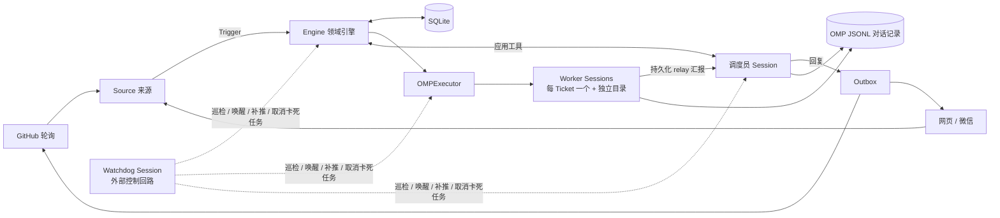

# omp-superagent

**一个能替你干活的"值班程序员"。** 你在 GitHub Issue / PR、本地网页或微信里 @ 它提需求，它先判断"该不该做、谁让做的"，通过后给每个任务开一个独立的 AI 工人，在单独的目录里写代码、跑命令，做完把结果回复到你提问的那个对话里。

基于 [Oh My Pi (OMP)](https://github.com/can1357/oh-my-pi)，一个服务只对应一个 GitHub 仓库。

> 设计原则：**占用人的注意力尽量少，给出的价值尽量多。** 只在被明确请求（或有你写好的规则）时行动；只在需要你决策或有结果时说话；失败如实说失败。

## 它能做什么

- **GitHub**：在 Issue/PR 里 `@agent 修一下 README 的错别字` → 确认收到 → 干活 → 回帖交付结果。
- **网页面板**（默认 `http://127.0.0.1:3082/`）：聊天、上传附件（≤3 个/条，≤5 MiB/个）、查看每个 Worker 进度、在线切换模型、连接 GitHub、重置会话。
- **微信**：面板「设置 → 微信」扫码绑定，直接在微信里发需求、收文件/图片。
- **后台任务、子代理与 Watchdog 看门狗**：Worker 的长命令超过 60 秒自动转后台，跑完立即唤醒 Worker，不再被固定超时盲目杀断；Worker 可派 `ticket-task` 子代理并行处理独立部分（每个 Worker 最多 8 个、嵌套 2 层）。独立的 **Watchdog Session** 组成外部控制回路（Control Loop），定时巡检基础设施异常、漏发的完成回复以及长任务语义进展——正常推进的长任务不打扰，卡死任务精准取消并唤醒恢复，外部后台任务跑完而 Worker 静默时自动唤醒交付；交接给人后留下的服务（如 dev server）保留到任务结束。
- **不做**：飞书、DSH 托管、在线改 Prompt。

## 快速开始

**前置**：Bun `>=1.4.4`、git `>=2.32`；已配置好模型提供商的 OMP `agentDir`；一个全新的空 `stateDir`（旧状态不会被迁移，直接拒绝）。若用 GitHub：需要一个专用账号（有仓库 push 权限）和对应的 `gh` 封装，别用个人账号。

**1. 写配置** `config.json`（路径均用绝对路径）。只用网页聊天时可去掉 `github`，之后也能在面板「设置 → GitHub」里填仓库和 `gh` 封装来连接（保存时校验账号与 push 权限，立即生效）：

```json
{
  "stateDir": "/srv/omp-superagent/state",
  "agentDir": "/srv/omp-superagent/omp",
  "sources": {
    "chat":   { "enabled": true, "config": {} },
    "github": { "enabled": true,
                "config": { "repository": "owner/repo", "cli": "/usr/local/bin/gh-agent", "pollSeconds": 60 } }
  },
  "policy": { "sources": {
    "chat":   { "allowed": [{ "id": "web:local" }] },
    "github": { "allowed": [{ "id": "your-github-login" }] }
  } },
  "eval":     { "mode": "observe", "model": null },
  "executor": { "model": null, "advisor": null, "maxWorkers": 3,
                "prepare": "git clone --quiet /srv/repositories/repo \"$OMP_SUPERAGENT_DIR\"" }
}
```

| 字段 | 含义 |
| --- | --- |
| `policy.…allowed` | 白名单：只有名单里的人能"明确下达"任务 |
| `eval.mode` | `off` 不主动评估；`observe` 只记录"我本来会做什么"（推荐起步）；`auto` 自动接受规则内的主动任务 |
| `executor.maxWorkers` | 同时工作的 Worker 上限 |
| `executor.prepare` | 为每个任务准备目录的 shell 命令，环境变量 `$OMP_SUPERAGENT_DIR` 即任务目录 |
| `*.model` | `null` 用 OMP 默认；或 `{provider, model, thinkingLevel}`；写了不存在的模型会启动失败，不会悄悄回退 |
| `executor.advisor` | Worker 顾问模型，格式同上；`null` 关闭。开启后第二个模型审阅 Worker 每个回合并插入建议，也可在「设置 → 模型」在线修改 |
| `web` | `{enabled, host, port}`，`port: 0` 为随机端口 |

**2. 构建并启动**

```sh
bun install
bun run build
./lib/cli.js --config /absolute/path/config.json   # 或 bun start -- --config ...
```

启动时会校验配置、模型、GitHub 身份与仓库权限，通过后打印 `omp-superagent ready` 和面板地址。`Ctrl-C`/`SIGTERM` 会有序关闭；模型和 GitHub 连接可在面板设置里在线修改，其余配置改动需重启。

**3. 使用**：在白名单账号下 `@<agent-login> 你的需求`，或直接在网页/微信里发消息。**不要删除 `stateDir` 里的 SQLite 和 JSONL**，它们保证重启后不重复回复。

**4. 验证**：`bun run check`（类型检查 + 测试 + 构建）；`bun scripts/omp-smoke.ts lib/cli.js`（离线端到端冒烟，假 provider + 假 `gh`）。

## 架构

一句话：**一个常驻"调度员"负责判断和回复，每个任务一个常驻"工人"负责干活，一个独立"看门狗"负责外部巡检与自愈，所有状态落盘。**



**一条请求的旅程**：`Trigger`（收到的消息）→ `Eval`（调度员评估：是否明确请求、发送者是否在白名单）→ `Decision/Mandate`（接受并授权）→ `Ticket`（任务单）→ `Assignment`（派给 Worker）→ Worker 汇报 → `Outbox` 回到原对话；长任务执行与回复全链路受 `Watchdog` 外部控制回路兜底守护。

**关键设计**

- **四类分工会话与高缓存命中**：调度员拿 `read` / `bash` 与路由回复工具；Worker 拿完整执行与子代理工具（100k 水位自动压缩 + 活跃期经济保活 + 全员共享 100% 静态系统前缀）；轻量无状态 `/btw` **Sidecar** 仅拿只读 `read` 与共享前缀缓存秒回进度/总结/对比追问（零唤醒重型 Worker）；独立 **Watchdog** 定时巡检与自愈。
- **极速异步与单跳直达**：微信连发消息经 1.8s 滑动微批聚合成单轮路由；UI 消息仅落盘不污染模型上下文；重活 `attach` 当轮秒回确认并打包全部待办 Input；Worker / Sidecar 支持 `direct_reply` 直推 Outbox 省去调度员二次中转。
- **Watchdog 零 Token 增量快筛 + 预采样无状态巡检**：每轮先在代码层做 `<5ms` 确定性修复与 `/proc` 子进程树 CPU ticks + 工作目录文件增量采样——正常推进的长任务 **0 次模型调用、0 Token 放行**；仅当连续零增量停滞、无绑定 PR 的 `idle` 工单脱离进程结束或遇到瞬态错误时，一次性预打包日志尾部、进程树与最近文件拉起无状态内存 Watchdog 会话（`low` 思考档位 + 静态前缀缓存），1~2 步内完成唤醒或精准取消卡死后台任务。
- **两份存储**：SQLite（`orchestrator.sqlite`）存领域状态、持久化 Effect 和 Outbox 顺序；JSONL 存对话记录与幂等消息 ID。重启后未完成的任务会续跑，已投递的消息不会重复。
- **并发**：`WorkerSlots` 限制同时运行数，唤醒优先于新启动，真人追问可临时多占一个名额。
- **启动/关闭**：`Runtime` 加锁状态目录 → 打开 SQLite → 校验 GitHub → 注册 Source → 恢复调度员与 Ticket → 启动轮询、Effect 与 Watchdog 控制回路；关闭时反向有序释放。

**状态目录**

```text
<stateDir>/
├── orchestrator.sqlite   领域状态 / Effect / Outbox / 微信绑定
├── sessions/             调度员与每个 Worker 的 JSONL（Sidecar 与 Watchdog 纯内存无状态）
├── omp/                  OMP 认证、模型、缓存（默认 agentDir）
├── work/                 每个 Ticket 的工作目录
├── attachments/          网页上传的大文件
└── worker-bin, worker-gitconfig   命令封装与隔离的 git 配置
```

**源码地图**

| 目录 | 职责 |
| --- | --- |
| `src/cli.ts`, `src/deployment.ts`, `src/policy.ts` | 入口、配置 schema、授权策略 |
| `src/core/` | 领域引擎：Ticket、Eval、Assignment、回复 |
| `src/app/` | Runtime、Session、投递、Effect、Sidecar 旁路快答、Watchdog 看门狗、Web 面板、微信、Worker 视图、模型设置、GitHub 连接、工具 |
| `src/sources/` | GitHub 与 chat 来源 |
| `src/executor/omp.ts` | 启动 / 唤醒 / 回收 Worker，后台任务管理与精准取消 |
| `prompts/`, `skills/`, `web/` | 提示词、技能、前端面板 |

## 文档

[000 理念](docs/000-philosophy.md) · [001 领域模型](docs/001-domain.md) · [002 授权](docs/002-authorization.md) · [003 执行](docs/003-execution.md) · [004 Prompt](docs/004-prompts.md) · [005 会话](docs/005-sessions.md) · [006 部署](docs/006-deployment.md) · [007 架构](docs/007-architecture.md) · [SETUP](SETUP.md)

## 许可

[MIT](LICENSE)
