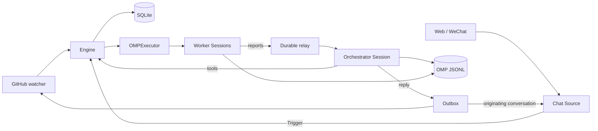

# 007 Architecture

## Closed loop

The standalone service keeps the domain chain: GitHub or chat Trigger → Eval → Decision/Mandate → Ticket → Assignment. `Runtime` locks the state directory, opens schema-1 SQLite, validates optional GitHub, writes worker shims, registers GitHub and chat Sources, applies startup settings, restores the orchestrator, resumes Tickets, then starts passes and durable Effects. The watcher waits for `ready`.

One persistent OMP orchestrator routes and assesses. Each Ticket has one persistent OMP worker in its own directory. Application tools call `Engine`; workers report through durable relay Effects; `Outbox` posts through GitHub or the originating chat conversation. No Cordis service, Feishu adapter, worker subagent manager or async background-job host exists.

Chat Threads are subscribed but not fanned out (`ScopeResult.fanout: false`): a chat message reaches no worker by itself and goes to Eval as a candidate, so one orchestrator turn picks the ticket and attaches it; only that worker runs. A chat card lists up to 20 tickets in the compact `routingCard` form: `title`, `asked` (the start of the request the ticket was accepted from), `digest` (the worker's latest `orchestrator_report` `topic`, else its latest report that was not a drop), `state` and `updated`. A worker that hands the message back returns it as `handed_back`; once three tickets have, the card tells the orchestrator to accept it as new work. The main Session answers chatter itself: a message reaches a ticket only as its origin or an Input, never by its Thread alone.

## Persistence and delivery

Aliases remain `orchestrator-<stateKey>` and `worker-<ticketId>`; OMP UUIDs stay outside the domain model. SQLite `session-file:<alias>` records each JSONL path. Reopen uses `throwIfMissing`; missing/corrupt files fail rather than creating empty history.

Every application message uses custom type `omp-superagent` and durable `requestId`. Delivery scans the full SessionManager branch and pending sends. Queue/steer/inject completes after the custom SessionEntry is visible and `flushToDisk()` succeeds; then domain acceptance and Input delivered/read commit. Duplicate IDs confirm again without another entry. Stop rejects pending sends for retry. Before-model hooks wait only for entry-visible confirmations because OMP emits initial entries after that hook.

Worker tool guards reread Ticket state and block built-in/custom tools after termination. Orchestrator tools contain only application tools. Workers add only `read`, `bash`, `edit`, `write`.

## Concurrency and shutdown

`WorkerSlots` counts actual `agent_start` separately from launch/wake reservations. Wake work precedes launches and one human follow-up may exceed `maxWorkers` by one slot. Only terminal `agent_end` finishes a turn; retry/compaction intermediate ends are ignored. OMP owns model retries.

Ticket stop synchronously calls `beginDispose()` before awaiting disposal. Runtime shutdown stops watcher/passes, begins disposal on all Sessions, drains Sessions and Effects, restores environment, closes SQLite and releases the lock.

## Modules

| Files | Area |
| --- | --- |
| `src/cli.ts`, `src/index.ts`, `src/deployment.ts`, `src/setup.ts`, `src/policy.ts`, `src/limits.ts`, `src/admission.ts`, `src/kv.ts` | Entry/configuration |
| `src/app/runtime.ts`, `src/app/sessions.ts`, `src/app/delivery.ts`, `src/app/effects.ts`, `src/app/passes.ts`, `src/app/web.ts`, `src/app/wechat.ts`, `src/app/wechat-protocol.ts`, `src/app/workers.ts`, `src/app/model-settings.ts`, `web/index.html`, `web/app.js`, `web/style.css` | Runtime/Sessions/Web panel/WeChat/Worker/Settings views |
| `src/executor/omp.ts`, `src/app/execution-environment.ts`, `src/app/outbox.ts`, `src/app/notices.ts` | Domain execution |
| `src/app/assessment.ts`, `src/app/resources.ts`, `src/app/cards.ts`, `src/app/context.ts`, `src/app/links.ts` | Assessment/resources |
| `src/app/prompts.ts`, `src/app/skill-files.ts`, `src/app/cache.ts`, `src/app/versions.ts`, `src/app/store.ts`, `src/app/store-read.ts`, `src/app/source-context.ts` | Prompt/state helpers |
| `src/app/tools/tool.ts`, `src/app/tools/main.ts`, `src/app/tools/executor.ts` | Session tools |
| `src/app/views/overview.ts`, `src/app/views/records.ts`, `src/app/views/sources.ts`, `src/app/views/tickets.ts`, `src/app/views/text.ts` | View projections |
| `src/core/model.ts`, `src/core/ids.ts`, `src/core/reasons.ts`, `src/core/errors.ts`, `src/core/stage.ts` | Core model |
| `src/core/engine.ts`, `src/core/part.ts`, `src/core/ports.ts`, `src/core/memory.ts`, `src/core/index.ts` | Core engine |
| `src/core/intake.ts`, `src/core/evals.ts`, `src/core/tickets.ts`, `src/core/assignments.ts`, `src/core/replies.ts` | Core behavior |
| `src/sources/github.ts`, `src/sources/github-trigger.ts`, `src/sources/github-channel.ts`, `src/sources/github-read.ts`, `src/sources/github-pull.ts` | GitHub Source |
| `src/sources/host.ts`, `src/sources/kind.ts`, `src/sources/registry.ts`, `src/sources/poll.ts`, `src/sources/admission-context.ts` | Source infrastructure |
| `src/sources/chat.ts` | Web/WeChat chat Source |
| `src/infra/commands.ts`, `src/infra/environment.ts`, `src/infra/paths.ts`, `src/infra/health.ts`, `src/infra/text.ts` | Process infrastructure |

## Tests

| Files | Coverage |
| --- | --- |
| `tests/omp-sessions.spec.ts`, `tests/omp-executor.spec.ts`, `tests/web-panel.spec.ts`, `tests/wechat.spec.ts`, `tests/chat-source.spec.ts`, `tests/worker-panel.spec.ts`, `tests/model-settings.spec.ts` | Real OMP Sessions/delivery, executor slots, Web API, WeChat iLink/CDN, chat Ticket flow, worker progress and model settings |
| `tests/fixtures/omp-openai-server.ts`, `tests/fixtures/deployment.ts`, `tests/fixtures/git.ts`, `tests/fixtures/async.ts`, `tests/fixtures/web-panel-fixture.ts` | CLI/provider/browser fixtures |
| `tests/deployment.spec.ts`, `tests/environment.spec.ts`, `tests/commands.spec.ts` | Deployment/environment/commands |
| `tests/policy.spec.ts`, `tests/core-engine.spec.ts`, `tests/assessment.spec.ts` | Policy/engine/assessment |
| `tests/store.spec.ts`, `tests/effects.spec.ts`, `tests/timeline.spec.ts` | Store/effects/timeline |
| `tests/prompts.spec.ts`, `tests/cards.spec.ts` | Prompts/cards/resources |
| `tests/github-read.spec.ts` | GitHub reads |
| `tests/stage.spec.ts`, `tests/passes.spec.ts`, `tests/cache.spec.ts`, `tests/class-docs.spec.ts`, `tests/docs.spec.ts` | Remaining behavior |

`tests/omp-sessions.spec.ts` uses pinned SDK, file-backed JSONL and the loopback provider. It verifies restricted tools, Ticket-ended blocks, idempotency, injection, steer/follow-up order, model restore and flush recovery. `scripts/omp-smoke.ts` additionally verifies real CLI/Runtime/Effects/Outbox behavior, completed Ticket, worker file, one acknowledgement/result, JSONL persistence, SIGINT and restart without duplicate work.
